# AWS EKS Cloud Native Platform

## Project Status

[](https://aws.amazon.com/)
[](https://kubernetes.io/)
[](https://kafka.apache.org/)
[](https://helm.sh/)
[](https://prometheus.io/)
[](https://grafana.com/)

**Current Version:** 1.0.0

**Status:** Complete. The full lifecycle has been run and verified end to end on a live cluster: build from an eksctl config, platform deploy, a push to `main` triggering CodePipeline through to a Helm deploy on EKS, the order flow under live traffic, metrics in Grafana, container logs in CloudWatch, an alert fired on purpose and delivered by email through SNS, then teardown and verification. A recorded walkthrough of that run is linked in [Demo](#demo). The app is intentionally not publicly exposed; access is via `kubectl port-forward`, consistent with the project's no-ALB, no-public-exposure design.

## Introduction

This project is a cloud native platform built on AWS EKS, designed to demonstrate hands on skills. It covers IaC, CI/CD pipeline design, container orchestration, event driven messaging with Kafka, observability (metrics, logs and alerting), and security practices like least privilege IAM and secret management, all built with a strict focus on cost control and full reproducibility.
The app itself (a simple order processing flow) exists mainly as something real to deploy and observe. The actual focus of this project is DevOps, not front-end development.

## Table of Contents

1. [Skills Demonstrated](#skills-demonstrated)
2. [Architecture](#architecture)
3. [Demo](#demo)
4. [Repository Structure](#repository-structure)
5. [Technology Stack](#technology-stack)
6. [CI/CD Pipeline](#cicd-pipeline)
7. [Security](#security)
8. [Observability](#observability)
9. [Engineering Challenges and Design Decisions](#engineering-challenges-and-design-decisions)
10. [Planned Improvements](#planned-improvements)
11. [AI Diligence Statement](#ai-diligence-statement)

## Skills Demonstrated

- IaC with CloudFormation, including automated security scanning with Checkov
- Automated pipeline security scanning across secrets, application code, and infrastructure (TruffleHog, Semgrep, Checkov), running in parallel
- AWS native CI/CD pipeline design (CodePipeline, CodeBuild) with GitHub as the source
- Container orchestration on EKS
- Kubernetes manifest management with Helm and Kustomize, including environment overlays
- Event driven architecture using Kafka (producer/consumer pattern)
- Cluster monitoring and alerting with Prometheus, Grafana and Alertmanager, including a purpose-built dashboard and an alert rule routed to SNS
- Centralised container logging with Fluent Bit to CloudWatch Logs
- Least privilege IAM design, split by responsibility between build and deploy roles, and three separate IRSA roles for in-cluster AWS access
- Capacity sizing driven by measured numbers rather than guesses
- Cost conscious infrastructure design
- Bash scripting for reproducible create/destroy workflows
- Local development workflow using Docker Compose, independent of the cloud

## Architecture

The application follows a simple producer/consumer pattern. A frontend calls an API service (order-service), which writes to PostgreSQL and publishes a message to Kafka. A worker service consumes that message and updates the record's status. This is intentionally minimal.

At the infrastructure level, CloudFormation provisions the ECR repository, artifact storage, and IAM roles. A second CloudFormation stack provisions the CI/CD pipeline itself, and a third provisions the permanent observability resources (the SNS alert topic, its email subscription, and the CloudWatch log group). EKS is provisioned separately via eksctl, deliberately kept out of CloudFormation so the cluster's expensive, short lived lifecycle (created only during active work) is decoupled from the long lived resources like ECR and IAM.

That split runs through the whole design. Anything that must survive a teardown lives in CloudFormation: the log group keeps its logs between sessions, and the SNS subscription keeps its one-time email confirmation. Anything scoped to a single cluster lives in the eksctl config or in the deploy script, including all three IRSA roles, because each new cluster gets a new OIDC issuer and the role trust policies are bound to it.

Secrets never enter the cluster as plaintext. AWS Secrets Manager holds the actual credentials, an IAM role scoped to that single secret is attached to a Kubernetes service account through IRSA, and External Secrets Operator syncs the value into a native Kubernetes Secret that the app consumes through a normal env var reference. Nothing in git, in a Helm values file, or in a manifest ever holds a real credential.

The observability layer follows the same principle. Alertmanager publishes to SNS and Fluent Bit writes to CloudWatch, both authenticating through IRSA with no stored URL, password or access key anywhere in the repository.

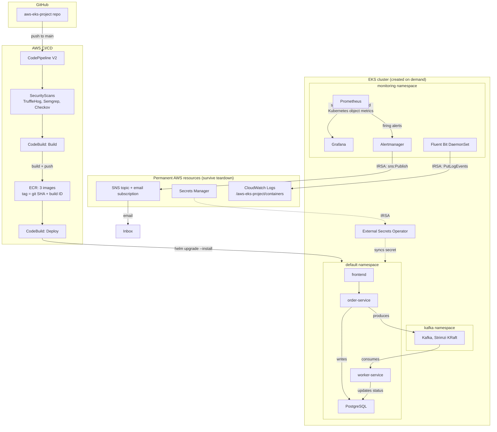

The cluster itself is two `t3.medium` on demand nodes in public subnets, with no NAT Gateway and no load balancer. Kubernetes is pinned to 1.34 in the eksctl config.

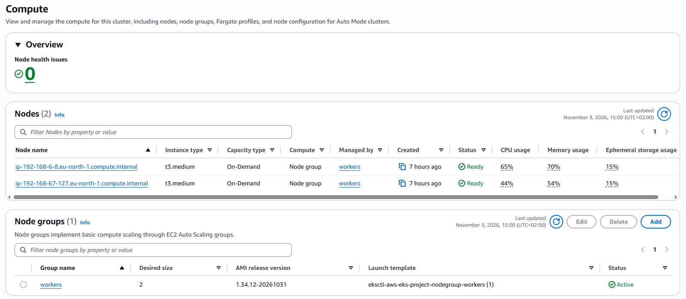

## Demo

A recorded walkthrough of a full session on the live cluster, from `rebuild.sh` through to a verified teardown. No narration; the video has chapters.

[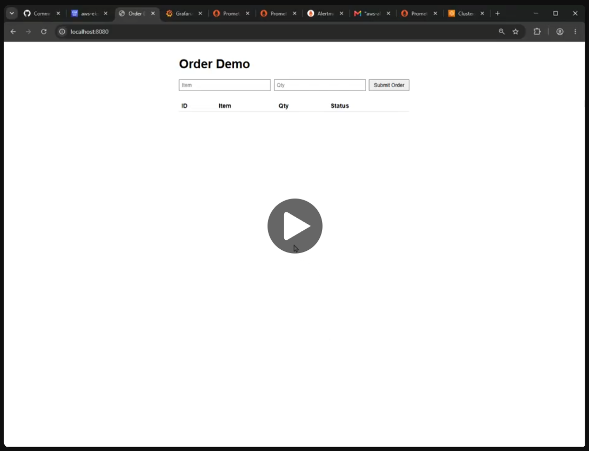](https://youtu.be/AP72i6fMmH8)

The order flow itself, which the video covers in its first half:

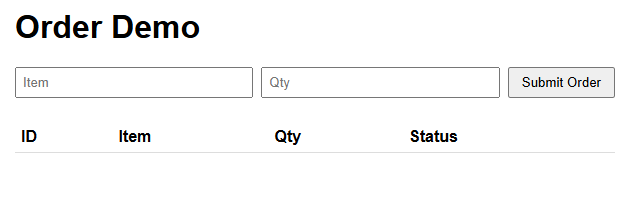

Frontend on first load, before any orders exist.

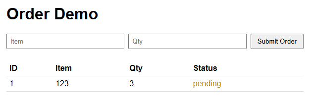

Right after submitting an order. The status reflects order-service's initial write, before worker-service has consumed the Kafka message.

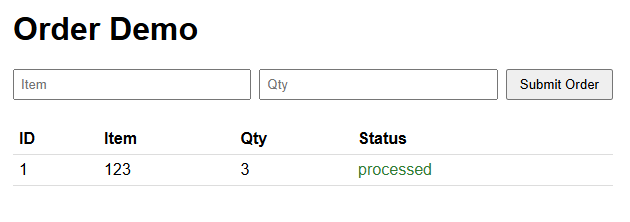

The same order moments later, updated by worker-service after consuming the message from Kafka and writing the new status to PostgreSQL.

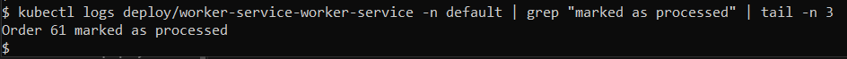

The underlying mechanism: worker-service consuming from the `orders` topic independently of order-service, and updating the record.

## Repository Structure

```
.
├── ansible/                 Cluster add-on bootstrap playbooks
├── apps/
│   ├── api/                 order-service (producer)
│   ├── frontend/            Static frontend
│   └── worker/              worker-service (consumer)
├── docs/
│   └── screenshots/         Screenshots used in this README
├── helm/
│   ├── frontend/            Helm chart for frontend
│   ├── order-service/       Helm chart for order-service
│   ├── postgres/            Helm chart for in-cluster Postgres
│   └── worker-service/      Helm chart for worker-service
├── infra/
│   ├── cloudformation/      CloudFormation templates (foundation, pipeline, observability)
│   └── eksctl/              EKS cluster configuration
├── k8s/
│   ├── base/                Base manifests (secrets, storage, Kafka, monitoring)
│   └── overlays/            Kustomize overlays (dev, demo, prod)
├── pipeline/                CodeBuild buildspecs (build, deploy, security scans)
├── scripts/                 rebuild.sh, deploy-infra.sh, deploy-pipeline.sh, teardown.sh, verify-teardown.sh, port-forward.sh
└── docker-compose.local.yml Local only stack for testing without AWS
```

## Technology Stack

- **IaC:** CloudFormation, eksctl
- **CI/CD:** CodePipeline, CodeBuild, GitHub (source, via CodeConnections)
- **Orchestration:** Amazon EKS, Helm, Kustomize
- **Messaging:** Apache Kafka (Strimzi, KRaft mode)
- **Secrets:** AWS Secrets Manager, External Secrets Operator, IRSA
- **Automation:** Ansible
- **Monitoring:** kube-prometheus-stack (Prometheus, Grafana, Alertmanager)
- **Logging:** Fluent Bit to CloudWatch Logs
- **Alerting:** Alertmanager to Amazon SNS, email delivery
- **Security scanning:** Checkov (IaC), TruffleHog (secrets), Semgrep (application code)
- **Languages/runtime:** Node.js (Express, KafkaJS), PostgreSQL

## CI/CD Pipeline

A push to `main` triggers CodePipeline via a CodeConnections link to GitHub. The pipeline has four stages:

1. **Source:** pulls the latest commit from GitHub. `DetectChanges: 'true'` is set explicitly rather than relying on the default, and the pipeline runs on CodePipeline V2 with path and branch filtered triggers, so pushes that only touch `docs/` or markdown files skip a full run.
2. **SecurityScans:** three CodeBuild projects run in parallel, each with its own least privilege IAM role limited to log writes and source reads: TruffleHog for leaked credentials, Semgrep for application code issues, and Checkov for CloudFormation misconfigurations. A finding in any one blocks the pipeline before an image is built.
3. **Build:** CodeBuild builds the three application images (order-service, worker-service, frontend) and pushes them to ECR. Tags combine the short git commit SHA with the CodeBuild build ID, not `latest`, since the ECR repository enforces immutable tags.
4. **Deploy:** a separate CodeBuild project, with its own IAM role that has no ECR access at all, reads the image tags the Build stage produced and runs `helm upgrade --install` for order-service, worker-service, and frontend against the live cluster. Source and Build share the pipeline's artifact store, with the Deploy stage taking both the built image manifest and the full source (for the Helm charts) as separate input artifacts.

All three app images live in a single ECR repository, differentiated by tag prefix (`order-service-`, `worker-service-`, `frontend-`) rather than separate repositories, since the project only needs one. Including the build ID in the tag means manually re-running a pipeline execution against the same commit never collides with ECR's immutable tag setting.

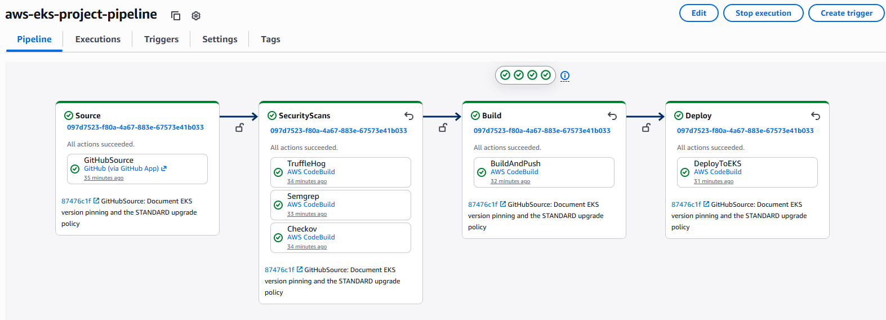

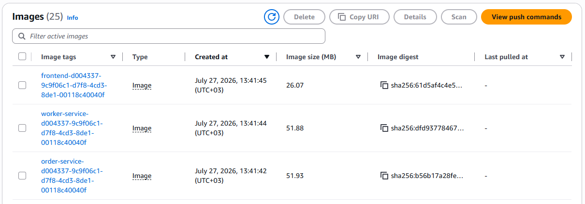

## Security

### Secrets Management

AWS Secrets Manager holds the actual credential values. An IAM policy scoped to a single secret ARN (read only, `secretsmanager:GetSecretValue` and nothing else) is attached to a Kubernetes service account through IRSA. External Secrets Operator watches a `ClusterSecretStore` backed by that service account and syncs the secret into a namespaced Kubernetes Secret, which PostgreSQL, order-service and worker-service consume via `secretKeyRef`. No credential is ever written to a file, a Helm values file, or committed to git.

A `ClusterSecretStore` is used instead of a namespaced `SecretStore` for a specific reason: ESO's admission webhook won't let a namespaced `SecretStore` reference a service account outside its own namespace, and the IRSA-bound service account lives in `external-secrets` while the synced secret needs to land in `default`.

One gap worth naming: the IAM policy that grants this access (`aws-eks-project-db-secret-reader`) was created by hand and is referenced by ARN from the eksctl config rather than being defined in a CloudFormation template. The role and service account that use it are fully declarative; the policy itself is not. Moving it into the foundation stack is listed under Planned Improvements.

### IAM and Access Control

CI/CD IAM roles are split by responsibility. The CodeBuild role can push to ECR and write to the artifact bucket only, with no Kubernetes access. The CodePipeline role can invoke CodeBuild and use the GitHub connection only. All CloudFormation templates are scanned with Checkov before deployment, with any accepted exceptions documented inline with reasoning.

IRSA is used for all in-cluster AWS access, across three separate roles declared in eksctl's `iam.serviceAccounts` config:

- External Secrets Operator, scoped to a single Secrets Manager ARN
- Alertmanager, scoped to `sns:Publish` on one topic ARN, plus `kms:GenerateDataKey` and `kms:Decrypt` on the one key that encrypts it
- Fluent Bit, scoped to `logs:CreateLogStream` and `logs:PutLogEvents` on one log group's streams

None of the three can reach any other resource, and none holds a long lived credential. Each role's whole lifecycle is created and destroyed with the cluster instead of being managed by hand. The Fluent Bit role is deliberately narrower than the plugin's documented permission set: because the log group is pre-created in CloudFormation with its retention policy already set, the plugin never needs `CreateLogGroup` or `PutRetentionPolicy`, so neither is granted.

The Deploy stage's CodeBuild role has an IAM permission to describe the cluster, but IAM alone doesn't grant it anything inside Kubernetes. An EKS access entry, declared in the eksctl cluster config, is what actually authorizes that role to act inside the cluster, scoped to edit permissions in the `default` namespace only, not cluster-admin. IAM and Kubernetes RBAC are separate systems here, deliberately: IAM decides who's allowed in, the access entry decides what they can do once inside.

### Network Exposure

The app is reachable only via `kubectl port-forward`, not a public endpoint. This was a deliberate choice, not a limitation worked around later: exposing the frontend and order-service via NodePort with a node's public IP was considered as a way to demo the project live from any machine, but rejected, since it would mean opening inbound access on infrastructure that's otherwise intentionally closed, for a benefit that's better served by a recorded walkthrough. `scripts/port-forward.sh` forwards the frontend, order-service, and the Prometheus, Alertmanager and Grafana UIs locally, matching the same `localhost` addressing already proven in `docker-compose.local.yml`.

### Automated Pipeline Scanning

Three tools run in the SecurityScans pipeline stage, each gating the pipeline on a finding rather than just reporting one after the fact. TruffleHog scans for leaked credentials and verifies matches against live APIs before reporting them, cutting down on false positives from plain pattern matching. Semgrep runs static analysis against the Node and Express application code using the javascript and security-audit rulesets. Checkov scans the CloudFormation templates for misconfigurations, replacing what was previously a one time manual check with an automated one on every push, using the same accepted exceptions already documented inline in the templates. Each tool runs as its own CodeBuild project with a dedicated IAM role scoped to log writes and source reads only.

The Checkov step originally scanned a single template by filename, which quietly left the pipeline and observability stacks unscanned as they were added. It now scans the whole `infra/cloudformation` directory, so any template added later is covered without anyone remembering to edit the buildspec. One check is skipped inline with its reasoning: `CKV_AWS_158` wants the CloudWatch log group encrypted with a customer-managed KMS key. The logs are already encrypted at rest by default and contain no secrets, and a customer-managed key brings key policy management and a minimum seven day deletion delay for no benefit at this scope. The Kubernetes manifests and Helm charts are not scanned at all, which is a real gap rather than a decision.

## Observability

Monitoring, logging and alerting were added as one layer, all three authenticating to AWS through IRSA rather than stored credentials.

### Monitoring

`kube-prometheus-stack` (chart 91.8.2) provides Prometheus, Grafana, Alertmanager, node-exporter and kube-state-metrics. Monitoring is infrastructure-only: the three application services expose no Prometheus metrics, which was confirmed by checking their dependencies rather than assumed, so the dashboard is built from node, pod and Kubernetes object metrics. Instrumenting the apps is listed under Planned Improvements.

The stack is rendered and patched by Kustomize rather than installed as a Helm release, using Kustomize's `helmCharts` generator. The alternative was a Helm post-renderer, which was rejected after checking the current state of both: Helm 4 removed support for passing an executable to `--post-renderer`, so that approach would need repackaging as a signed plugin. Kustomize simply runs `helm template` in a subprocess, which works the same on Helm 3 and 4. The trade-off is losing Helm's release tracking and rollback, which matters very little on a cluster that is rebuilt from scratch every session.

Because the chart's CRDs and the custom resources that depend on them land in one apply, `deploy-infra.sh` renders the chosen overlay to a file once, applies it server-side, waits for the CRDs to be established, then applies the same file again. Server-side apply is required here because the Prometheus Operator CRDs are too large for client-side apply's annotation-based diffing.

Four scrape targets are explicitly disabled: etcd, the scheduler, the controller manager and kube-proxy. EKS does not expose those control plane components, so their default alerts would fire permanently and flood the alert email.

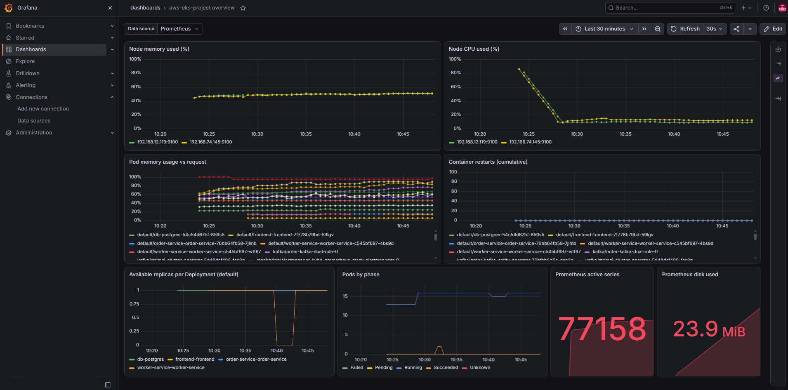

The custom dashboard covers node memory and CPU, pod memory against its request, container restarts, available replicas per deployment, pods by phase, and Prometheus's own series count and disk usage. It is delivered as a ConfigMap generated by Kustomize from a plain JSON file, labelled `grafana_dashboard: "1"` so Grafana's sidecar loads it automatically. Keeping the dashboard as JSON rather than embedded in YAML means it can be validated and diffed on its own.

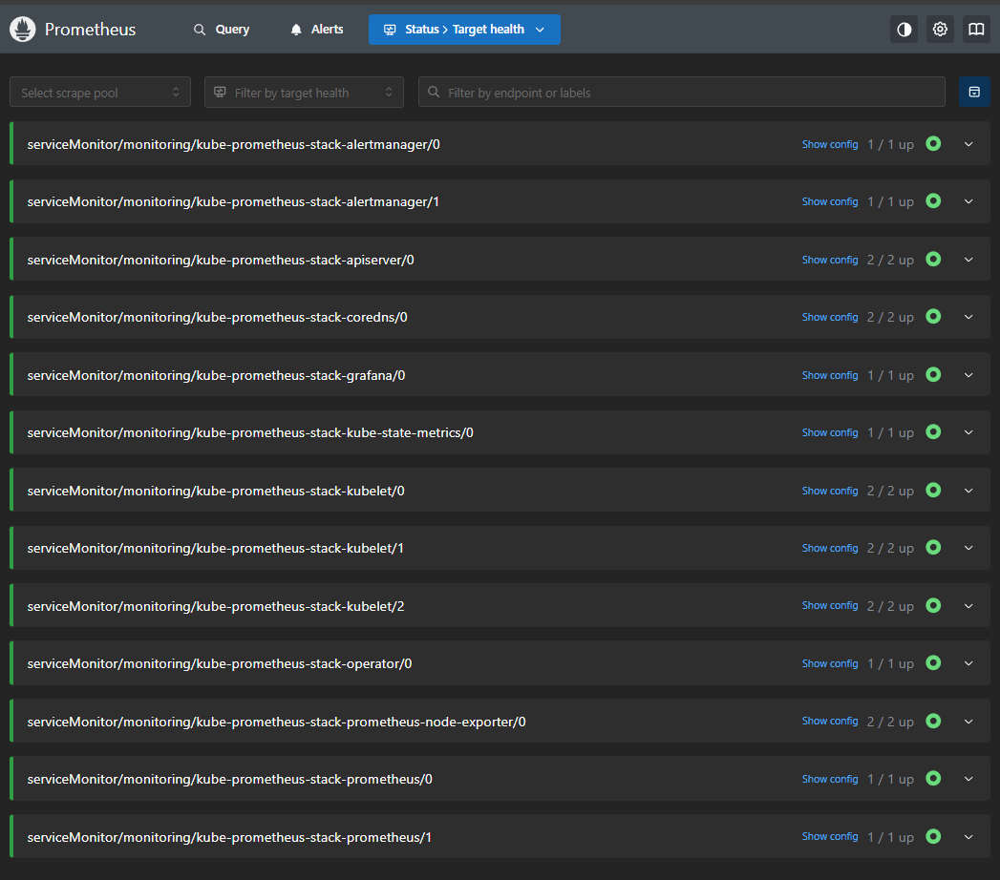

Grafana's admin password is generated with `openssl rand` by `deploy-infra.sh` and stored in a Kubernetes Secret, created only if one does not already exist. It is never written to git and never rendered into a manifest, so re-running the deploy script on a live cluster cannot silently change it.

### Logging

Fluent Bit runs as a DaemonSet, one pod per node, reading the container log files from the node and shipping them to a CloudWatch log group. It uses the core `cloudwatch_logs` output plugin rather than the older Go plugin, and the log group is pre-created in CloudFormation with a seven day retention policy, so the group outlives the cluster and Fluent Bit never needs permission to create it.

The tail input is scoped by filename glob to the `default` and `kafka` namespaces only. System namespaces and Fluent Bit's own output are excluded, which keeps the log group readable and the ingestion volume down. CloudWatch Logs charges on ingestion rather than storage, so what gets shipped is the lever that matters.

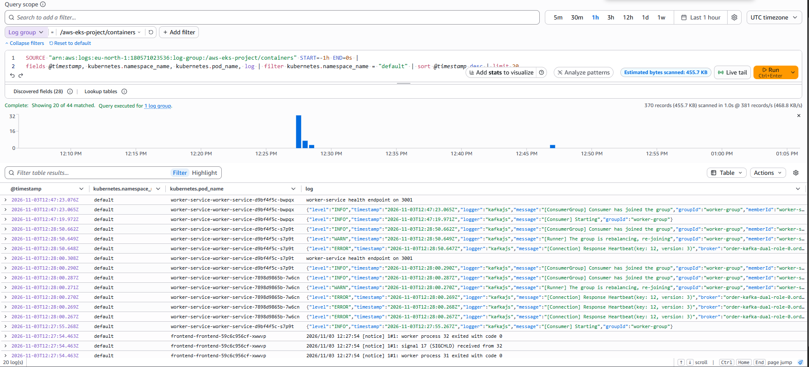

Fluent Bit's Kubernetes filter enriches each record with the pod name, namespace, labels, host node and container image before shipping it, which is what makes a Logs Insights query like the one above useful rather than a wall of undifferentiated text.

### Alerting

Prometheus evaluates a custom rule, `DeploymentNoAvailableReplicas`, which fires when any deployment in the `default` namespace has zero available replicas. Alertmanager routes it to an Amazon SNS topic, which delivers an email.

SNS was chosen over a chat webhook after working through the alternatives. A Teams webhook was ruled out because Microsoft retired Office 365 connectors in favour of Workflows, which needs a work or school account. Discord was rejected for personal reasons unrelated to the technology. SMTP through SES was rejected because it means storing a credential and configuring an identity. SNS needs no stored secret at all: Alertmanager's `sns_configs` receiver signs its requests with SigV4 and picks up credentials from the default chain, which on EKS is the IRSA role. There is no webhook URL, no password and no access key anywhere in the repository, and the mail arrives from AWS rather than from a mailbox belonging to anyone.

Routing is explicit about what does not get sent. Everything goes to a `null` receiver by default, and only `severity: critical` is routed to SNS. That single rule suppresses the chart's hundreds of built-in alerts, including the always-firing `Watchdog` heartbeat, without having to silence them one by one.

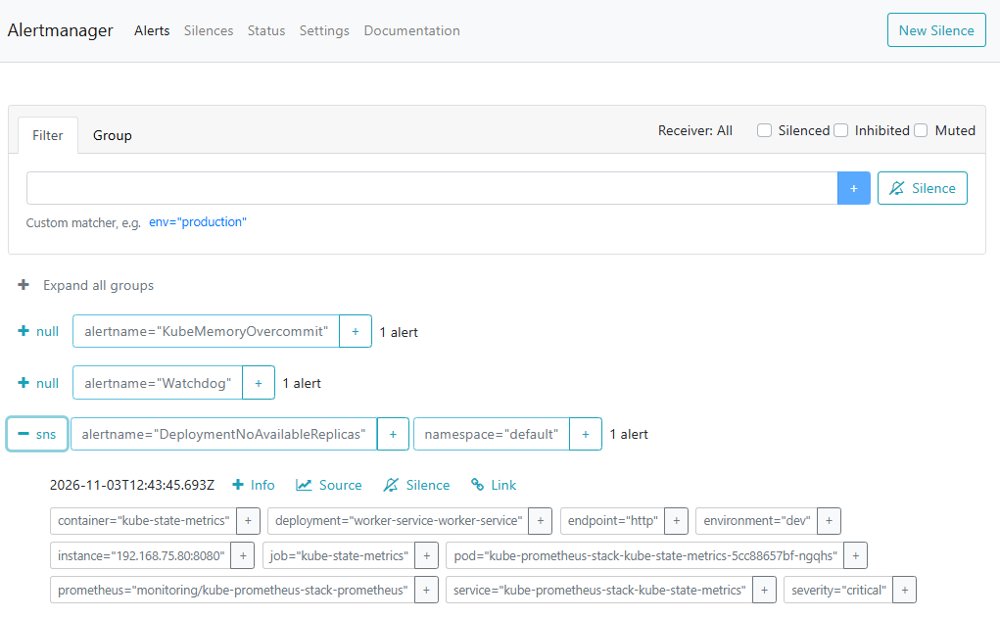

The Alertmanager view above is the routing design made visible: `KubeMemoryOvercommit` and `Watchdog` were grouped to the `null` receiver and dropped, while `DeploymentNoAvailableReplicas` went to `sns` and produced an email.

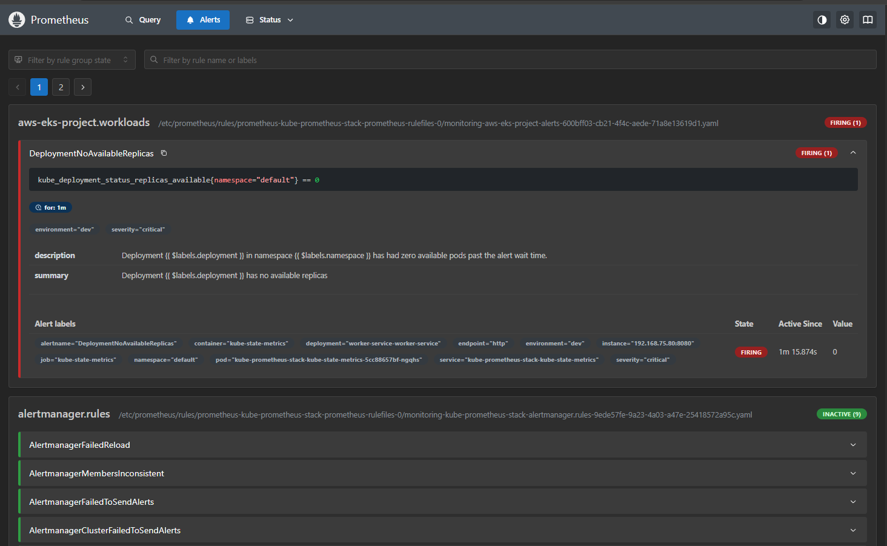

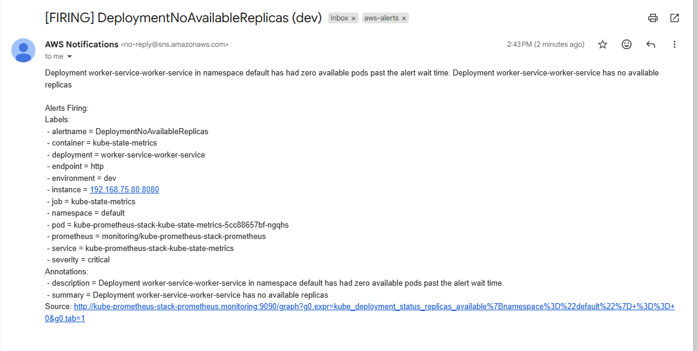

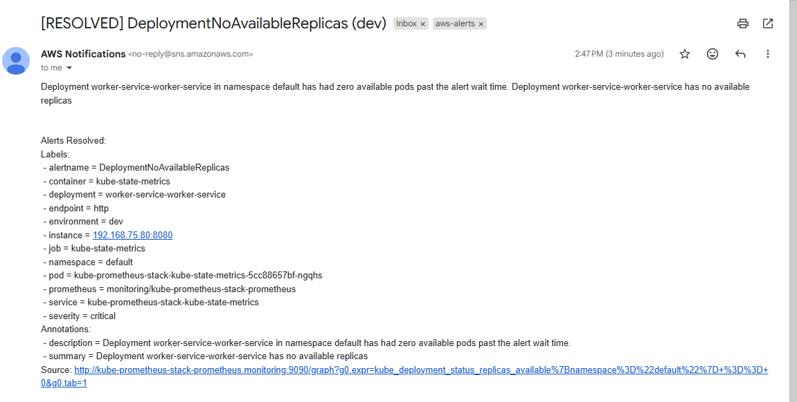

`send_resolved` is on, so the recovery is notified as well as the failure. An alert that fires and never clears tells you less than half of what happened.

### Environment overlays

Three Kustomize overlays sit on top of the rendered stack:

- **dev** is the default, labels everything `environment=dev`, and waits 10 minutes before the deployment alert fires. Long enough that a slow first deploy, where a pod has no available replicas while its image pulls, never pages anyone.
- **demo** inherits dev and changes exactly one value, shortening that wait to 1 minute, so the full alert cycle can be demonstrated in about two minutes instead of eleven. It exists so the demo never requires editing the real configuration and remembering to change it back.
- **prod** is illustrative and has never been deployed on this cluster. It waits 5 minutes rather than dev's 10, on the reasoning that production should react faster than a development environment, widens the alert's scope to also watch the `external-secrets` and `kafka` namespaces, and raises Prometheus to 15 day retention on a 20Gi volume. It is validated by `kustomize build` only, and the README would rather say that plainly than imply it runs.

### Capacity, measured

The monitoring stack was sized against real numbers from a live cluster rather than chart defaults, then corrected twice when the first guesses turned out to be wrong.

| Stage | Node 1 | Node 2 |
|---|---|---|
| Empty cluster, system pods only | 16% | 15% |
| Platform: monitoring, Kafka, PostgreSQL, operators | 70% | 52% |
| Platform plus the three app services | 77% | 57% |
| Same, under sustained traffic | 77% | 58% |

Memory use barely moves under load; the platform itself is what consumes the nodes. The binding constraint turned out not to be memory at all, which is covered under Engineering Challenges.

## Engineering Challenges and Design Decisions

**Cost driven redesign:**
The original plan assumed a larger, always available EKS setup. As it became clear the EKS control plane has no free tier at all, the project was redesigned around a minimal footprint: small on demand nodes, no NAT Gateway, no load balancer, and a strict habit of tearing the cluster down between work sessions using create/destroy scripts.

**AWS Free Plan instance restrictions:** 
New AWS accounts are limited to free tier eligible instance types unless certain conditions are met. This surfaced as a failed node group creation and required adjusting node sizing.

**T3 burstable CPU credits:** 
T3 instances default to "unlimited" credit mode, which can bill extra if sustained CPU usage exceeds baseline. Nodes are explicitly set to "standard" mode instead, trading potential throttling for predictable cost.

**Bitnami image deprecation:** 
Bitnami moved most of its container catalog behind a paid tier in 2025, breaking a planned dependency on `bitnami/kafka` for local testing. Local Kafka testing was moved to Apache's own official image instead.

**Licensing:** 
An open source reference app was initially considered for the demo application, but lacked a license file. Rather than risk redistributing unlicensed code in a public repo, a small purpose-built app was written instead.

**metrics-server: EKS addon over Helm.** Originally planned to install metrics-server via Helm alongside the other add-ons, for consistency. It turns out metrics-server already ships as an EKS-managed addon, and running the Helm chart on top of it caused ownership conflicts on the resources it manages. Switched to relying on the addon, declared in the eksctl cluster config so it's still IaC-tracked, and removed the Helm-based role entirely rather than leaving it disabled in place.

**No default StorageClass on a fresh EKS cluster.** PostgreSQL's PVC stayed stuck in `Pending` because eksctl doesn't install the EBS CSI driver by default, and even once it's added, nothing marks a StorageClass as default automatically. Fixed by adding the driver as a managed EKS addon and creating a `gp3` StorageClass with `is-default-class` set explicitly.

**External Secrets CRD version drift.** Manifests written against `external-secrets.io/v1beta1` failed with "no matches for kind" even though the CRDs were installed, because the chart version in use only serves `v1`. Traced by checking `served: true/false` per version on the CRD directly, then updated the manifests.

**Strimzi operator crash on Kubernetes 1.34.** The Strimzi 0.45.0 operator crashed on startup with a Jackson deserialization error, unable to parse a new `emulationMajor` field EKS 1.34 added to its version response. This is a known upstream issue in Strimzi's bundled Kubernetes client. Fixed by upgrading to Strimzi 0.51.0 and adding `STRIMZI_KUBERNETES_VERSION` as an explicit env var as a safety net, both encoded in the Ansible role rather than patched by hand on a live pod.

**ZooKeeper removal and Kafka version pinning.** Strimzi dropped ZooKeeper support entirely as of 0.46.0, so the original `Kafka` CR (written against 0.45.0) had to be rewritten around `KafkaNodePool` and KRaft mode. Separately, the broker refused to start with `version: 3.8.0`, since 0.51.0 only supports a specific whitelist of Kafka versions. Both issues trace back to the same mistake: bumping the operator version without checking its compatibility matrix against everything downstream of it.

**Helm does not upgrade CRDs.** After bumping the Strimzi chart version, the operator pod ran fine but the Entity Operator crash looped with 404s against the Kafka API. Helm upgrades a chart's Deployment but doesn't touch CRDs by default. Fixed by applying the matching CRD bundle directly as its own Ansible task, ordered before the Helm install so it can't race the operator's startup again.

**teardown.sh scoped too broadly, then deliberately widened.** The teardown script was originally deleting the CloudFormation foundation stack (ECR, S3, IAM) on every run, not just the EKS cluster. This stayed hidden until CloudFormation's own export-dependency protection blocked a delete and surfaced the mistake, and it was fixed by scoping the script to the eksctl-managed cluster only. Adding a PVC for Prometheus later required widening it again, but in a different direction: the script now uninstalls the volume-owning workloads and deletes the PVCs in `default`, `kafka` and `monitoring` before deleting the cluster, because an EBS volume provisioned through a PVC is only cleaned up when the claim is deleted while the cluster still exists. Every in-cluster step is best-effort and never blocks the cluster deletion, since the cluster disappearing is what actually stops the bill. The script also looks up the kubectl context eksctl created for this specific cluster rather than using whatever context happens to be current, because another cluster is sometimes active on the same machine and a teardown script that deletes workloads is the last place to assume.

**A teardown check that silently passed.** `verify-teardown.sh` reports orphaned EBS volumes after a teardown, and it was filtering on a `KubernetesCluster` tag. The EBS CSI driver does not set that tag; it sets `ebs.csi.aws.com/cluster` along with tags naming the PVC and its namespace. The filter therefore matched nothing and the check reported clean every time, whether or not anything had been left behind. Caught while reading the driver's tagging documentation for an unrelated reason. Fixed to filter on the driver's own tag and to print the originating PVC and namespace for anything it finds. A check that cannot fail is worse than no check, because it is trusted.

**Postgres data does not persist across sessions.** Postgres runs on an EBS-backed PVC, which gets destroyed along with the cluster on every teardown, by design, since the cluster itself only exists during active work blocks. Accepted deliberately: a demo dataset doesn't need to survive between sessions, and keeping storage ephemeral avoids extra EBS spend on top of the compute budget.

**Rebuilding the cluster does not restore supporting infrastructure.** `eksctl` recreates nodes, addons, and the EKS access entry, but ESO, the secrets sync, PostgreSQL, and Kafka all have to be reapplied by hand every session, since none of them are addons. This stayed implicit until a full pipeline run failed against a freshly rebuilt cluster with nothing but bare nodes on it. Fixed with `scripts/deploy-infra.sh`, which reapplies all of it in the correct order, with explicit wait conditions so the app layer can never race ahead of dependencies it needs.

**Unquoted colons broke buildspec YAML twice.** A shell command like `cut -d: -f1` contains a colon immediately followed by a space, which YAML's plain scalar syntax treats as an ambiguous mapping key, not literal text. This surfaced first in the Deploy stage's buildspec, then again in the Build stage's buildspec when a later fix reintroduced the same pattern without quoting. Fixed by wrapping any buildspec command containing a bare `: ` in double quotes, and validating buildspecs with an actual YAML parser rather than eyeballing them going forward.

**A quiet bug found while re-checking a different one.** While verifying the colon-quoting fix with an actual parser instead of trusting it by eye, a second, unrelated bug turned up in the same file: a multi-line `printf` command relied on shell backslash line continuation, but CodeBuild's buildspec YAML folds multi-line list items into a single line before the shell ever sees them, turning the continuation backslashes into literal stray characters. That silently prepended a leading space to every image URI written into the pipeline's output artifact. Caught and fixed in the same pass as the colon issue, rather than discovering it later as a second, separate failure.

**CodePipeline needs an explicit primary source with multiple input artifacts.** The Deploy stage needs both the built image manifest and the repository's Helm charts, so it was given two input artifacts. CodeBuild silently failed to find its own buildspec until `PrimarySource` was set explicitly, telling CodePipeline which of the two artifacts to check out as the working directory.

**order-service's real dependency didn't match its documented one.** The architecture describes order-service as Kafka-producer-only, with no database access. In practice, the code connects to PostgreSQL on startup regardless. This only surfaced once the app was actually deployed and crash-looping, not from a code review. The Helm chart was updated to match what the application actually does, rather than changing the app to match the diagram.

**GitHub App installation vs. authorization.** The CodeConnections GitHub link showed as "Available" and the pipeline ran once on creation, but never triggered on subsequent pushes. The cause: the AWS Connector for GitHub app was authorized but never actually installed to the repository, two distinct steps on GitHub's side. Installing it directly resolved automatic triggering.

**Helm release naming redundancy, left as-is.** Chart name and release name happen to match for several services (`order-service`, `frontend`), producing redundant resource names like `order-service-order-service` and `frontend-frontend`. Purely cosmetic, no functional impact, and fixing it would mean touching every chart's naming convention for zero real benefit. A deliberate call not to spend time on it given the project's scope and remaining priorities.

**Node memory headroom forced an earlier size bump.** With PostgreSQL, Kafka, and all three app services running, both nodes were already sitting around 85 percent memory before any monitoring stack was added. Rather than wait and risk kube-prometheus-stack failing to schedule, `t3.small` was bumped to `t3.medium` ahead of schedule. Managed nodegroups can't change instance type in place, since it's set in the launch template at creation, but the project's always torn down between sessions habit made this a non issue: the next rebuild just creates the new nodegroup fresh.

**The real constraint was pod slots, not memory.** After the monitoring stack and the apps were running, memory sat at 77 and 58 percent, with plenty of room on paper. Pod capacity did not: a `t3.medium` allows 17 pods, a limit set by how many IP addresses the VPC CNI can attach to that instance type, and the two nodes were running 17 and 14 of a possible 34. Three free slots across the whole cluster. The stack's own `KubeletTooManyPods` alert flagged it before it caused a failure, which is exactly what it exists for. It matters because a rolling update needs a spare slot to start the new pod before stopping the old one, so the cluster was closer to being unable to deploy than any memory graph suggested. Left as-is for a two node demo cluster; a third node or VPC CNI prefix delegation is the fix at any real scale.

**Grafana was being OOM killed twice over, and the symptom looked like a network problem.** The first deploy of the monitoring stack left Grafana at 1/3 containers ready and crash looping. Both of its sidecars, the ones that load dashboards and datasources from ConfigMaps, were exiting with code 137 against a 64Mi limit that had been estimated rather than measured. Raising them to 256Mi fixed those, but the main Grafana container then started dying too, and this time the symptom was indirect: `kubectl port-forward` would drop with "connection refused" and "lost connection to pod" partway through loading a dashboard. That reads like a networking fault, and it is actually a container being killed and restarted underneath the forward. Grafana was using 252Mi against a 256Mi limit while idle, so opening the UI was enough to push it over. Raised to a 512Mi limit with a 256Mi request, the request having been set below actual usage, which is its own small mistake: the scheduler was reserving less than the pod was always going to use.

**`deploy-infra.sh` reported success while Grafana was crash looping.** The script waits on `kubectl wait --for=condition=Available deployment --all` before declaring the stack ready, and that wait passed during the OOM problem above. A Deployment can report Available between container restarts, so the condition was true at the moment it was checked and false seconds later. The script's success message means the apply completed and the waits returned, not that every pod is healthy, and the pod list is still the real check.

**Amazon SNS rejects a subject over 100 characters, and Alertmanager's default subject is longer.** The first alert fired correctly, routed correctly, and failed to deliver with `unexpected status code 400: Invalid parameter: Subject`. The 400 was informative in itself: the request had reached SNS and been authenticated, so IRSA was working and the problem was one field. Alertmanager's default subject template appends the labels shared across the alert group, and with everything kube-state-metrics attaches that comfortably exceeds SNS's limit. Fixed with an explicit short subject template built from the alert status, name and environment. Two details worth recording: the stack's own `AlertmanagerFailedToSendAlerts` rule fired while this was broken, so the monitoring noticed its own delivery failure, and a static subject string was the first fix before being replaced with a templated one, because a hardcoded `[FIRING]` would have labelled the recovery email as a failure.

**A Postgres health probe was failing its login every five seconds and nothing noticed.** Found by accident while reading CloudWatch to confirm Fluent Bit worked: the Postgres log contained `FATAL: role "root" does not exist`, repeating on the readiness and liveness probe intervals. The probes ran `pg_isready -U "$(POSTGRES_USER)"`, and the kubelet only expands `$(VAR)` in a probe command from environment variables with a literal value in the pod spec. `POSTGRES_USER` comes from a Secret, so it expanded to nothing, libpq fell back to the container's OS user, and Postgres rejected the login every time. The probes still passed, because `pg_isready` checks that the server is accepting connections rather than that the credentials work, so the pod was healthy and the failure was invisible outside the logs. Fixed by running the probe through a shell, where the container's real environment is available, and passing the database explicitly. Worth the entry less for the bug than for how it was found: the logging pipeline earned its keep on its first day by surfacing something no dashboard was watching for.

**Kafka was one burst away from being OOM killed.** Under a sustained order load, the broker reached 494Mi against a 512Mi limit, or about 96 percent, having sat at 417Mi idle. It had not been killed, but there was no margin for a heavier burst, and a broker dying mid-demo takes the message flow with it. Raised to a 640Mi request and 768Mi limit, after which the same load peaked at 579Mi. The JVM heap settings were deliberately left alone: the problem was the space outside the heap, not the heap itself.

**Chart inflation over post-rendering, decided by checking rather than habit.** Patching a Helm chart's output with Kustomize is conventionally done with a post-renderer script. Checking the current state of both tools first turned out to matter: Helm 4, released in late 2025, no longer accepts an executable path for `--post-renderer` and requires a signed plugin instead, so the conventional approach was already on a deprecation path. Kustomize's own `helmCharts` generator runs `helm template` in a subprocess and works identically on Helm 3 and 4. It also meant the alert rule and the dashboard could be built in the same pass as the chart rather than applied separately. The cost is Helm's release tracking and `helm rollback`, which are worth little on a cluster rebuilt from scratch each session.

**A deploy blocked by a GitHub outage.** A cluster rebuild failed partway through with `504 Gateway Timeout` while Helm fetched the External Secrets chart, which is served from a GitHub release asset rather than a chart registry. GitHub itself was reachable in a browser at the time; only the asset download was failing. A retry a few minutes later worked, and `deploy-infra.sh` is written to be safely re-runnable, so nothing had to be unwound. It is still a single point of failure in the rebuild path that has nothing to do with AWS, and mirroring the charts into ECR is listed under Planned Improvements.

**Considered, then rejected, a self mutating pipeline.** Rather than running `scripts/deploy-pipeline.sh` by hand whenever `pipeline.yaml` changes, the pipeline could in principle deploy changes to its own definition automatically, the pattern AWS CDK Pipelines uses. Rejected for three reasons: the added scope isn't justified at this project's size, the IAM role it would need (`iam:PassRole`, `iam:CreateRole`) is a meaningfully larger blast radius than any other role in this project, and a self mutating stage only applies its own changes on the next trigger, not the run that deployed them, which is a real behavioral gotcha rather than a clean improvement.

**EKS version pinning and the extended support surcharge.** The cluster config originally set no Kubernetes version at all, so `eksctl` chose its own default and a rebuild could have landed on a different version than everything was tested against. The version is now pinned to `1.34` in `cluster.yaml`. Separately, clusters created by `eksctl` default to an `EXTENDED` upgrade policy, which keeps a cluster on its current version once standard support ends and bills $0.60 per cluster-hour instead of $0.10. Standard support for 1.34 ends on December 2, 2026. The policy is set to `STANDARD` instead, so AWS upgrades the control plane at end of standard support rather than charging the surcharge. Giving up control of upgrade timing is the right side of that trade here specifically because the cluster is rebuilt from `cluster.yaml` every session and never lives long enough for an automatic upgrade to reach it. Two constraints are worth recording: the policy can only be set when the cluster is created, and a cluster that has already entered extended support cannot be taken back out of it except by upgrading.

## Planned Improvements

- **Instrument the application services**: the three apps expose no Prometheus metrics, so monitoring is infrastructure-only and the dashboard cannot show request rates, error rates or latency. Adding a metrics library and a `/metrics` endpoint to the two Node services, plus Kafka's own broker metrics through Strimzi, would turn this from cluster monitoring into application monitoring.
- **Move the `db-secret-reader` IAM policy into CloudFormation**: it is currently referenced by ARN from the eksctl config but was created by hand, which is the one piece of the secrets chain not defined in code.
- **Kubernetes version upgrade**: everything here was built and verified against 1.34, which leaves standard support on December 2, 2026. Moving to 1.35 or later means re-running the full verification pass (monitoring stack, Strimzi, External Secrets, app deployment) against the new version. The Strimzi 0.45.0 crash on 1.34 is a reminder that a control plane bump breaks things downstream of it.
- **Migrate the Strimzi manifests from `v1beta2` to `v1`**: every `kubectl apply` of the Kafka resources now prints a deprecation warning. Harmless today, since the operator still serves both, and a hard failure the day it stops.
- **Extend Checkov to Kubernetes and Helm manifests**: the pipeline scans every CloudFormation template but nothing under `k8s/` or `helm/`, so the IaC coverage stops at the AWS boundary.
- **Customer-managed KMS key for the CloudWatch log group**: would satisfy the one Checkov check currently skipped inline. Deferred because a customer-managed key carries a minimum seven day deletion delay, which sits badly with a project built around tearing everything down on demand.
- **Mirror third-party Helm charts into ECR**: a cluster rebuild currently depends on GitHub release assets and upstream chart repositories being available, which has already blocked a deploy once.
- **Multi-account Landing Zone** (AWS Organizations, Control Tower, SCPs): intentionally out of scope. This project runs in a single account by design; a landing zone is an org-governance pattern that doesn't fit a single-cluster, cost-constrained demo project. Worth a separate, dedicated project rather than bolting it onto this one.
- **OPA/Gatekeeper or Kyverno**: policy-as-code admission control (block root containers, enforce resource limits), a natural next step for cluster-level governance.
- **kube-bench**: CIS Kubernetes benchmark checks against the cluster, not implemented due to time scope.
- **Vault or Doppler**: alternative/complementary secrets backends to Secrets Manager.
- **Service mesh** (Istio, Linkerd): mTLS and traffic policy between services.
- **Route53**: DNS management, not needed at this project's scale.
- **ECR lifecycle policy**: expire untagged and old images automatically. Several debugging sessions left behind stray image tags with no cleanup, similar to the lifecycle rule already applied to the S3 artifact bucket.
- **S3 artifact lifecycle rule that actually fires**: the existing rule on the pipeline's artifact bucket never matches anything, because CodePipeline writes each execution's artifacts under a unique key rather than overwriting a fixed one. A separate root cause from the ECR gap above, and the bucket grows unchecked in the meantime.
- **Automated dependency and tool version updates**: TruffleHog, Semgrep, and Checkov versions are currently pinned by hand in the buildspecs. Dependabot or Renovate would open scheduled pull requests for version bumps instead, with major version bumps flagged for manual review given the risk of breaking changes.
- **Self mutating pipeline**: worth revisiting at a scale where the added IAM trust (see Engineering Challenges and Design Decisions) is justified by how often the pipeline definition actually changes.

## AI Diligence Statement

This project was developed with the assistance of large language models as engineering tools. They were used to augment learning, planning, execution and problem solving, while all architectural decisions, implementation choices and final responsibility remain with me.

I remain responsible for every design decision, line of code and infrastructure change included in this repository.
